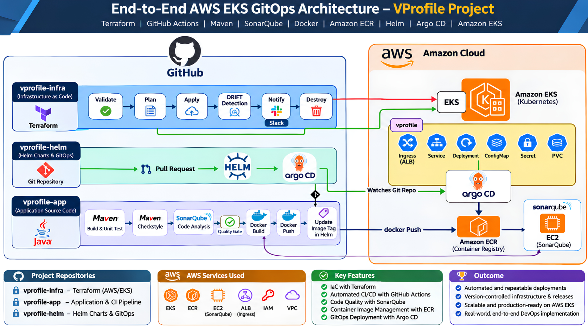

# End-to-End AWS EKS GitOps Platform

A real-world DevOps project showcasing an end-to-end delivery workflow using **AWS, Terraform, GitHub Actions, Maven, SonarQube, Docker, Amazon ECR, Helm, Argo CD, Kubernetes, and Amazon EKS**.

This public repository is the **showcase and documentation layer** for the project. The actual implementation is maintained across separate private repositories for infrastructure, application CI, and Helm/GitOps configuration.

---

## Project Overview

The goal of this project is to build and demonstrate a complete DevOps delivery platform where:

- AWS infrastructure is provisioned using Terraform
- Application code is built and tested through CI
- Code quality is analyzed with SonarQube
- Docker images are built and pushed to Amazon ECR
- Kubernetes deployment configuration is maintained using Helm
- Argo CD continuously synchronizes the desired state to Amazon EKS
- Git is used as the source of truth across the delivery lifecycle

---

## High-Level Architecture

<p align="center">
  
</p>

```text
                         GitHub
                            |
          +-----------------+-----------------+
          |                 |                 |
          v                 v                 v
   vprofile-infra      vprofile-app      vprofile-helm
      Terraform        Maven / CI          Helm / GitOps
          |                 |                 |
          v                 v                 v
         AWS           Docker Image          Argo CD
          |                 |                 |
          v                 v                 v
         EKS <--------- Amazon ECR ---------> EKS
```

---

## Repository Architecture

```text
PRIVATE IMPLEMENTATION REPOSITORIES

vprofile-infra
    |
    `-- Terraform / AWS / EKS infrastructure

vprofile-app
    |
    `-- Application source / Maven / CI / SonarQube / Docker / ECR

vprofile-helm
    |
    `-- Helm charts / Kubernetes configuration / Argo CD GitOps


PUBLIC SHOWCASE REPOSITORY

aws-eks-gitops-project
    |
    `-- Architecture / Documentation / Sanitized Examples / Evidence
```

---

## Technology Stack

| Area | Tools / Services |
|---|---|
| Cloud | AWS |
| Kubernetes | Amazon EKS |
| Container Registry | Amazon ECR |
| Infrastructure as Code | Terraform |
| CI/CD | GitHub Actions |
| Build Tool | Maven |
| Code Quality | SonarQube |
| Containers | Docker |
| Package Management | Helm |
| GitOps | Argo CD |
| Ingress | AWS Load Balancer Controller / ALB |
| Source Control | Git & GitHub |
| Notifications | Slack |
| Operating System | Linux |

---

## Infrastructure Workflow

```text
Terraform Code
      |
      v
Terraform Validate
      |
      v
Terraform Plan
      |
      v
Terraform Apply
      |
      v
AWS Infrastructure
      |
      v
Amazon EKS
```

Additional workflow components:

```text
Drift Detection
      |
      v
Infrastructure Status
      |
      v
Slack Notification
```

---

## Application CI Workflow

```text
Developer Push
      |
      v
GitHub Repository
      |
      v
Maven Build
      |
      v
Unit Tests
      |
      v
Checkstyle
      |
      v
SonarQube Analysis
      |
      v
Docker Build
      |
      v
Amazon ECR
```

---

## GitOps Deployment Workflow

```text
New Application Image
        |
        v
Update Helm Image Tag
        |
        v
vprofile-helm Repository
        |
        v
Argo CD Detects Change
        |
        v
Argo CD Sync
        |
        v
Amazon EKS
        |
        v
VProfile Application
```

---

## Helm Chart

```text
helm/vprofile/
|
|-- Chart.yaml
|-- values.yaml
`-- templates/
    |-- app-deployment.yaml
    |-- db-deployment.yaml
    |-- mc-deployment.yaml
    |-- rmq-deployment.yaml
    |-- services.yaml
    |-- ingress.yaml
    |-- secret.yaml
    |-- pvc.yaml
    `-- dockerregistry-secret.yaml
```

The chart includes configuration for:

- Application
- Database
- Memcached
- RabbitMQ
- Init containers
- AWS ALB Ingress
- Persistent storage
- Application secrets
- Optional Docker registry authentication

---

## AWS ALB Ingress

```text
Internet
   |
   v
AWS ALB
   |
   v
Kubernetes Ingress
   |
   v
Application Service
   |
   v
Application Pods
```

Ingress configuration includes:

```text
Ingress Class : alb
Scheme        : internet-facing
Target Type   : ip
HTTPS         : 443
SSL Redirect  : 443
Backend       : HTTP
```

Environment-specific values such as certificate ARNs and domain names are intentionally excluded from this public repository.

---

## GitOps Principles Used

- Git is the source of truth
- Infrastructure and deployment configuration are version controlled
- Application delivery is automated
- Kubernetes desired state is stored in Git
- Argo CD reconciles Git with the EKS cluster
- Application CI and Kubernetes deployment are separated
- Changes remain traceable through commits and repository history

---

## Public Repository Structure

```text
aws-eks-gitops-project/
|
|-- docs/
|   |-- architecture/
|   |   `-- gitops-architecture.png
|   |
|   |-- screenshots/
|   |
|   |-- infrastructure.md
|   |-- ci-pipeline.md
|   `-- gitops-workflow.md
|
|-- examples/
|   |-- terraform/
|   |-- github-actions/
|   |-- helm/
|   `-- argocd/
|
|-- CHANGELOG.md
|-- .gitignore
`-- README.md
```

---

## Security & Public Repository Policy

This public repository does not contain sensitive values.

Excluded items include:

```text
AWS Access Keys
AWS Secret Keys
AWS Account IDs
Private SSH Keys
GitHub Tokens
Slack Webhook URLs
Kubeconfig Files
Terraform State Files
Real Certificate ARNs
Registry Passwords
Environment Secrets
Private Endpoints
```

Any example configuration will use sanitized or placeholder values.

---

## Implementation Status

```text
[✓] Repository architecture planned
[✓] Private repositories created
[✓] SSH-based Git access configured
[✓] Helm repository initialized
[✓] Kubernetes manifests converted to Helm
[✓] AWS ALB ingress configuration added

[ ] Complete infrastructure implementation
[ ] Provision AWS EKS environment
[ ] Configure Amazon ECR
[ ] Configure SonarQube
[ ] Build application CI workflow
[ ] Configure Argo CD
[ ] Connect Helm repository to Argo CD
[ ] Complete end-to-end deployment
[ ] Add project evidence
[ ] Tag first stable release
```

---

## Project Evidence

Implementation evidence will be added under:

```text
docs/screenshots/
```

Planned evidence:

```text
Terraform workflow
AWS infrastructure
Amazon EKS cluster
Amazon ECR repository
CI pipeline execution
SonarQube analysis
Docker image publication
Helm chart validation
Argo CD application
Argo CD synchronization
AWS ALB
Running VProfile application
```

---

## Release Strategy

The project will use semantic versioning:

```text
MAJOR.MINOR.PATCH
```

```text
Bug Fix                   -> PATCH
New Non-Breaking Feature  -> MINOR
Major Architecture Change -> MAJOR
```

---

## Planned First Stable Release

```text
v1.0.0
```

Target:

```text
Original architecture implemented successfully end-to-end.
```

The initial implementation will follow the current architecture before introducing later architectural improvements.

---

## Key Learning Goals

- AWS infrastructure design
- Terraform-based infrastructure provisioning
- Kubernetes on Amazon EKS
- CI pipeline design
- Maven application builds
- Automated testing and quality analysis
- Docker image lifecycle
- Amazon ECR
- Helm packaging
- GitOps deployment methodology
- Argo CD synchronization
- Kubernetes ingress with AWS ALB
- Git-based environment management
- Infrastructure drift detection
- End-to-end DevOps troubleshooting

---

## Complete Delivery Flow

```text
Developer
   |
   v
GitHub - vprofile-app
   |
   v
Maven Build
   |
   v
Tests / Checkstyle
   |
   v
SonarQube
   |
   v
Docker Build
   |
   v
Amazon ECR
   |
   v
Update Helm Image Tag
   |
   v
GitHub - vprofile-helm
   |
   v
Argo CD
   |
   v
Amazon EKS
   |
   v
VProfile Application
```

Infrastructure runs alongside this workflow:

```text
GitHub - vprofile-infra
        |
        v
Terraform
        |
        v
Validate / Plan / Apply
        |
        v
AWS Infrastructure
        |
        v
Amazon EKS
```

---

## Author

**Ambuj Mishra**

GitHub: [ambujmishra1997](https://github.com/ambujmishra1997)

---

> This repository is intended as a public technical case study of the complete AWS EKS GitOps project. Sensitive implementation repositories and environment-specific configuration remain private.
